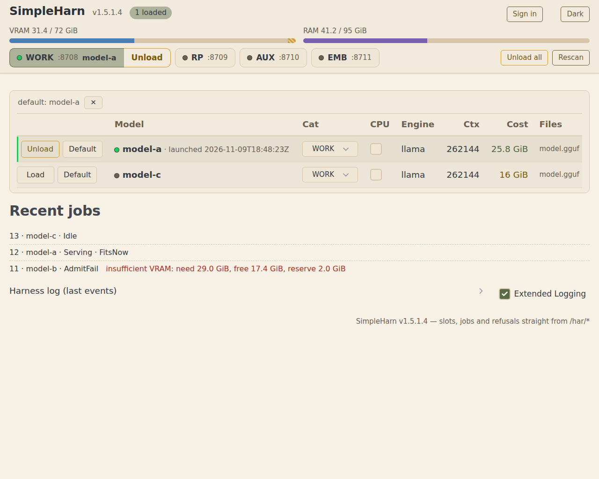

# SimpleHarn

[](https://github.com/legislat/SimpleHarn/actions/workflows/ci.yml)

SimpleHarn is a local LLM harness for Windows and Linux. On Windows it runs as a
tray app; the tray is an optional feature and the headless build is the supported
Linux form. It runs several inference engines on one GPU behind one
OpenAI-compatible API. That API is an OpenAI subset: the
model list plus the chat, completion, and embeddings routes. The
[compatibility matrix](docs/reference/COMPATIBILITY.md) names the covered surface and the
gaps. One swap scheduler is the only writer
of scheduler state. It admits every model load against the memory the card itself reports,
and it refuses to overcommit. The product name is SimpleHarn, and the repository is
`legislat/SimpleHarn`. The binary is `simpleharn` (`simpleharn.exe` on Windows), the config file is `simpleharn.json`,
and the environment names use the `SIMPLEHARN_` prefix.

Current release: **v1.5.1.4**. Windows 10/11 and Linux x86-64 (headless; glibc
2.16 or newer, see Requirements), one NVIDIA GPU, single user. Prebuilt
binaries: see the GitHub Releases page of this repository. The release
zip holds `simpleharn.exe`, `SimpleHarn.vbs`, `README.md`, `LICENSE`, and
`docs/assets/control-page.png`. The Linux tar.gz from the same tag carries the
headless binary and the same docs. Models and engine installs are yours.

A build made from a tagged, clean source tree embeds its exact tag as the
release identity, and `/har/status` carries both identities: `version` stays
the three-part crate semver and `release` names that tag or null (an untagged
or dirty build reports none); the control page header shows the release when
the build carried one.

> This is a personal harness, built for my own machine and my own setup. Feel free to try
> it out, give feedback, and contribute.

Admission is the product. A load that does not fit the card never starts. Every refusal
names its numbers and its blockers, in the API and on the control page:

```text
insufficient VRAM: need 24.0 GiB, free 18.3 GiB, reserve 2.0 GiB; blocked by: my-coder (nothing may evict WORK)
```



## Who this is for

You run local LLMs on Windows or Linux with one NVIDIA GPU. You want several models that swap
quickly, each on its own OpenAI-compatible endpoint, with no console windows to manage.
You want one safe budget manager that never force-loads onto a full GPU and names the
blockers and the numbers on every refusal. You do not want to deal with software juggernauts
with a million different options and built-in chat, downloader, and more.

The `llama` path (llama.cpp) works on any machine that can run `llama-server.exe`. The
`strata`, `basalt`, `maya`, and `ninfer` paths run when their engine is installed; see
[ENGINE-RECIPES.md](docs/reference/ENGINE-RECIPES.md) for the wiring. They are tested on
this operator's machine and may need adjustment elsewhere. Compared with llama-swap, which also swaps models, SimpleHarn
adds a memory-accounting scheduler that refuses to overcommit. What this is not: it is
not multi-user, it is not a router for remote or cloud engines, and it is not a replacement
for llama-swap. It runs and supervises local engines on one machine only.

This software is provided AS-IS, with no warranty of any kind. See
[LICENSE](LICENSE) (Apache-2.0).

## Documentation style

The docs in this repository are written in ASD-STE100 (Simplified Technical English) on
purpose: short sentences, active voice, one idea per sentence. People and software agents
can parse them reliably. The trade is that some pages read terse.

## Quick start

### Prebuilt

1. Download `SimpleHarn-1.5.1.4-win-x64.zip` from the Releases page and unzip it.
2. Put one flat `.yaml` row in `ModelConf` beside the exe. The harness creates that
   folder on boot if it is missing; it does not create an example row. Start from a
   minimal llama row. The file stem, for example `example`, is the model identity:

   ```yaml
   engine: llama
   model: <models-root>\example-model.gguf
   category: WORK
   vram_gb: 8.0
   cost: fixed
   context: 8192
   ```

   Replace the placeholder model path with one real absolute GGUF path. Ready rows
   for every engine are in [examples/](examples/README.md). The `import` verb emits
   row keys from a manual Strata profile; see
   [docs/reference/CLI.md](docs/reference/CLI.md). The full schema is in
   [docs/reference/MODELS.md](docs/reference/MODELS.md).
3. Double-click `SimpleHarn.vbs`, open `http://127.0.0.1:8708/`, and load the model.
   On Linux download `SimpleHarn-1.5.1.4-linux-x64.tar.gz` from the same
   release, extract it, and run `./simpleharn` headless (no tray, no VBS).

### From source

You need Rust. `rust-toolchain.toml` pins the build toolchain to Rust 1.98.1.
rustup installs the pinned toolchain on the first build. The minimum supported
Rust version (MSRV) is 1.88. CI checks the crate on the MSRV on Windows and
Linux.

```powershell
cargo build --release --features tray
```

The tray is an optional feature. Omit it for a headless build; the harness then
runs without the icon and logs one warning if `tray_enabled` is set. Linux uses
the headless build: llama, strata, basalt, maya and xolotl serve there, ninfer
runs its container inside the distro, the card legs and the bash suite runner
pass in WSL2, and the tag workflow builds the Linux artifact. Engine packs and
models can stay on the Windows drives under `/mnt`.

1. Put one flat `.yaml` file per model in `ModelConf` beside the built exe. The harness
   creates the folder on boot if it is missing. Start from a ready row in
   [examples/](examples/README.md).

   ```yaml
   engine: llama
   model: <path-to-model>.gguf
   category: WORK
   vram_gb: 8.0
   cost: fixed
   context: 8192
   ```

   The filename, for example `example.yaml`, is the model identity. The schema is in
   [MODELS.md](docs/reference/MODELS.md).

2. Run `target\release\simpleharn.exe` with the `ModelConf` folder beside it. First run
   probes the GPU total (NVML), prefers a `llama-server.exe` found on PATH, and records
   the winner. It writes the authoritative `simpleharn.json` beside the exe, and it binds
   loopback only. The binary embeds no engine install path. `llama_server_exe`
   is an optional global default. A llama row may override it for its own
   fork. It never overwrites a config file that already exists. The harness
   ignores an old `simplehar-se.json` or `simplehar.json` file and creates
   `simpleharn.json`.

   To start it without a console window, double-click `SimpleHarn.vbs` beside the exe.
   Run `simpleharn.exe` directly when you want the live tracing console.

3. Open `http://127.0.0.1:8708/`. Load one model on the page. The harness starts that
   model's engine. No engine runs before a load.

The four category listeners on ports 8708-8711 answer the OpenAI-compatible API.

## How it works

- **Single writer.** The scheduler is the only component that changes slot and budget
  state. Every load and unload passes through one decision point.
- **The witness is the budget truth.** Admission reads the live VRAM figure from the card,
  minus a reserve. The harness never books more than the card reports, so it never
  overcommits.
- **Refusals name their reasons.** Every refusal lists the blockers and the numbers, on
  the page and in the API.
- **Eviction is a one-way matrix.** Nothing evicts WORK. Only WORK evicts RP. WORK and RP
  evict AUX and EMB. Same-slot replacement is always allowed. When several victims would
  cover the deficit, the planner takes the cheapest sufficient set.
- **Config file is king.** One JSON file beside the exe plus one flat YAML file per model.
  The catalog reloads on rescan; page edits write back to `simpleharn.json`, and keys that
  bind at boot take effect on restart.

## Categories and ports

| Category | Public port | Slots | Purpose | Evicted by |
|---|---|---|---|---|
| WORK | 8708 | 1 | coding/agent work; also hosts the control page + `/har/*` | nobody |
| RP | 8709 | 1 | roleplay | WORK |
| AUX | 8710 | 1-6 | utility models | WORK, RP |
| EMB | 8711 | 1 | embeddings | WORK, RP |

The four category names are display-only defaults. A `categories` entry can
set an optional `label` to rename what the page and `/har/status` show. The
ids stay the vocabulary: requests, model yamls, and the eviction matrix keep
using them. This table is a summary of the documented defaults. The category
port matrix, the engine port plan, and the eviction rules live in
[docs/reference/CONFIG.md](docs/reference/CONFIG.md).

## Control page and tray

The page shows category tabs (each naming its port, loaded resident, and inline
Unload control), memory bars (observed VRAM, the reserve, in-flight bookings,
host RAM), per-model rows with Load and Default, recent jobs, and the harness log. A
rescan re-reads the catalog; a failed action shows its reason once, in a
  dismissible banner between the tabs and the table, or as the job row when the
  server recorded one; a serving model keeps the launch it was spawned with, so an
edit to a live model takes effect on its next load. The tray shows green loaded, yellow
swap in flight, gray idle, or red listener down. The menu offers Open Web UI, the
unload actions, and Exit.

## Configuration

The authoritative `simpleharn.json` sits beside the exe; page edits persist to
it. Each model is one flat `key: value` YAML file in `ModelConf`. The core
keys cover the bind address, the control token, the categories, the admission
ceiling, and the catalog directory. The full field table, the environment
variables, the category port matrix, and the eviction rules are in
[docs/reference/CONFIG.md](docs/reference/CONFIG.md). The model schema and the
engine knobs are in [docs/reference/MODELS.md](docs/reference/MODELS.md).

## HTTP API

Each public listener answers the OpenAI-style endpoints `/v1/models`,
`/v1/chat/completions`, `/v1/completions`, and `/v1/embeddings`. A request that names no
model goes to the loaded model of that category, or to its `default_model` when nothing is
loaded. The control routes, memory provenance, and error codes are in
[docs/reference/API.md](docs/reference/API.md).

## Security

The API is unauthenticated by default, and it binds to loopback. Set
`SIMPLEHARN_TOKEN` (or `control_token`) before any non-loopback bind. A
non-loopback `internal_host` such as `0.0.0.0` with no token now refuses to
start; the refusal names both remedies. To accept that posture on purpose, set
`allow_unauthenticated_network_bind` to `true`; the harness then boots and the
control page shows a persistent warning banner on every read. Do not expose the
harness to a LAN without a token. With a token set,
every route except the page assets requires it. The harness forces every
engine it starts onto a loopback listener, whatever `internal_host` says. The
full policy is in [SECURITY.md](SECURITY.md); the token and bind keys are in
[docs/reference/CONFIG.md](docs/reference/CONFIG.md).

## Requirements

Windows 10 or 11, or Linux x86-64 with glibc 2.16 or newer, one NVIDIA
GPU. The prebuilt Linux artifact is built in a pinned manylinux2014
container base, whose glibc is 2.17; the artifact itself requires
`GLIBC_2.16` at most, so it runs on Ubuntu 18.04 and newer, Debian 9 and
newer, and RHEL 7 and newer. Build from source on older hosts. The tag
workflow measures the floor with `objdump` on every artifact and fails if
a build ever needs more than the documented floor. The witness loads the
NVIDIA driver's `libnvidia-ml.so.1` at runtime, so an installed driver is
required; without it the witness falls back to `nvidia-smi`. A fully
static musl build is not shipped: the static-pie musl build produced
here answered `Dynamic loading not supported` for `libnvidia-ml.so.1`
and could not read the card through NVML (measured 2026-11-10). The
`llama` path needs a llama.cpp build that runs `llama-server`
(`llama-server.exe` on Windows); first run detects one found on PATH. The
`strata`, `basalt`, and `maya` paths need their engine install and its Python
environment. The `ninfer` path needs WSL2 and Docker on Windows; on Linux it uses the
Docker daemon inside the same distro and runs a GPU container.
The `xolotl` path needs a source-built engine and its Python environment.
GPU memory is read through NVML with an `nvidia-smi` fallback. One GGUF file
is needed per `llama` model. Minimal per-engine setup is in
[ENGINE-RECIPES.md](docs/reference/ENGINE-RECIPES.md).

Engine status as of 2026-11-09. "Verified here" means one witnessed load on the
operator's machine, the setup proof that
[ENGINE-RECIPES.md](docs/reference/ENGINE-RECIPES.md) and
[COMPATIBILITY.md](docs/reference/COMPATIBILITY.md) carry. An engine absent
from that proof is unproven, not broken. The Linux column states what the
harness has proven there, with the per-engine evidence rows in COMPATIBILITY.
The harness ships Windows 1.5.1.4 and a headless Linux artifact built from the
same tag.

| Engine | Verified here | Linux |
|---|---|---|
| `llama` | Yes | Yes: upstream primary platform |
| `strata` | Yes | Yes: source install |
| `basalt` | Yes | Yes: source install, Blackwell cards only |
| `maya` | Yes | Yes |
| `ninfer` | Yes | Yes: the container runs inside the same WSL distro |
| `xolotl` | Yes | Yes: Linux source build, same 256K profile |

## Troubleshooting

Common cases: a port that will not bind (a Hyper-V/WSL2 reservation often
covers it), a missing model file at boot (the scan drops the row and reports
it), and a repeated refusal (unload something; the harness never
over-admits). The full list, with the `netsh` fix for reserved ports and the `ss` twin on
Linux, is in
[docs/reference/TROUBLESHOOTING.md](docs/reference/TROUBLESHOOTING.md).
Operator recovery procedures are in [docs/reference/RUNBOOK.md](docs/reference/RUNBOOK.md).

## Docs, help, and license

| Topic | Where |
|---|---|
| Agent entry point | [AGENTS.md](AGENTS.md) |
| Binding invariants | [docs/architecture/DOCTRINE.md](docs/architecture/DOCTRINE.md) |
| Architecture overview | [docs/architecture/OVERVIEW.md](docs/architecture/OVERVIEW.md) |
| HTTP API reference | [docs/reference/API.md](docs/reference/API.md) |
| OpenAI compatibility matrix | [docs/reference/COMPATIBILITY.md](docs/reference/COMPATIBILITY.md) |
| Security policy and reporting | [SECURITY.md](SECURITY.md) |
| Operations reference | [docs/reference/OPERATIONS.md](docs/reference/OPERATIONS.md) |
| Troubleshooting | [docs/reference/TROUBLESHOOTING.md](docs/reference/TROUBLESHOOTING.md) |
| CLI verbs | [docs/reference/CLI.md](docs/reference/CLI.md) |
| Operator runbook | [docs/reference/RUNBOOK.md](docs/reference/RUNBOOK.md) |
| Model schema reference | [docs/reference/MODELS.md](docs/reference/MODELS.md) |
| Example model rows | [examples/README.md](examples/README.md) |
| Configuration reference | [docs/reference/CONFIG.md](docs/reference/CONFIG.md) |
| Documentation map | [docs/DOCS_README.md](docs/DOCS_README.md) |
| Contributing | [CONTRIBUTING.md](CONTRIBUTING.md) |
| Changelog | [CHANGELOG.md](CHANGELOG.md) |
| License | [LICENSE](LICENSE) (Apache-2.0) |
| Issues | [legislat/SimpleHarn/issues](https://github.com/legislat/SimpleHarn/issues) |

Found a problem or have an idea? Open an issue. Contributions are welcome; start with
[CONTRIBUTING.md](CONTRIBUTING.md).

## Plans

- Multiple GPU support
- More engines and engine recipes
- UI and user experience enhancements

## Rename from SimpleHar SE

The project shipped under the working name SimpleHar SE. An unrelated utility named
SimpleHAR, a HAR-file viewer, already used that name. The product, binary, crate, config
file, env names, wire identifiers, and custody dirs are now SimpleHarn. There is no
backward compatibility and no migration. The harness ignores an old `simplehar-se.json`
or `simplehar.json` config file. The old `SIMPLEHAR_*` environment names are inert. The
harness never reads the old wire values or the old `.simplehar` custody dirs.

## Special thanks

- [llama.cpp](https://github.com/ggml-org/llama.cpp)
- [llama-swap](https://github.com/mostlygeek/llama-swap)
- [berth](https://github.com/T-Crypt/berth)
- [Strata](https://github.com/Niko1221/Strata)
- [Xolotl](https://github.com/Indras-Mirror/Xolotl)
- [Basalt](https://github.com/jesdga95/basalt)
- [NInfer](https://github.com/Neroued/ninfer)
- [NInfer-all](https://github.com/iamwavecut/ninfer-all)
- [Project Maya](https://github.com/mw00/project-maya)
